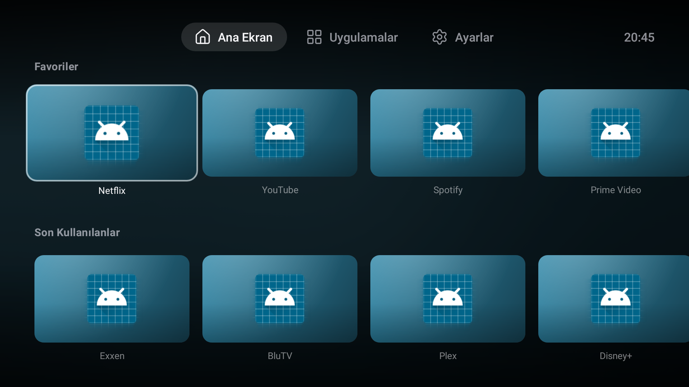
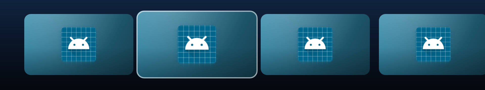

# Mi Apple Launcher

Xiaomi **Mi Box S (2. nesil)** ve diğer Android TV / Google TV cihazları için,
Apple TV (tvOS) arayüzünden ilham alan hızlı bir ana ekran başlatıcısı.



Odaklanan kart tvOS'taki gibi büyür, hafifçe eğilir, üzerinden ışık parlaması
geçer ve altına gölge düşer:



> Ekran görüntüleri gerçek `MainActivity` çalıştırılarak otomatik üretilir
> (`app/build/screenshots/`). Buradaki uygulama simgeleri test ortamının
> varsayılan simgeleridir; cihazda her uygulama kendi simgesiyle görünür.

---

## Neler var

**Apple TV hissi**
- 16:9 yatay, köşeleri yuvarlatılmış kartlar — tvOS kutucuklarının karşılığı
- Odak efekti: yay (spring) animasyonlu %111 büyüme, yükselen gölge,
  çapraz geçen parlama (specular sheen) ve geliş yönüne göre 3B eğilme
- Odaklanan uygulamanın renklerini arka plana yayan **ortam arka planı**
- Seçim sabit kalır, raf altından kayar — D-pad ile gerçek bir TV hissi
- Üstte sade sekme çubuğu (Ana Ekran / Uygulamalar / Ayarlar) ve saat

**Günlük kullanım**
- **Favoriler** rafı — sabitle, sola/sağa taşı
- **Son Kullanılanlar** rafı — ekstra izin gerekmez, kendi sayacını tutar
- TV uygulamaları ve telefon uygulamaları ayrı raflarda
- Tüm uygulamalar ızgarası
- Uzun basınca (veya MENU tuşu) kart menüsü: aç, favori, gizle,
  uygulama bilgisi, kaldır
- Arayüz tamamen **Türkçe** — cihazın sistem dili ne olursa olsun
- 5 duvar kağıdı, efektleri açma/kapatma

**Hız** — 2 GB RAM'li bir kutuda akıcı kalması için:
- Uygulama listesi tek bir sekmeyle ayrılmış metin dosyasına yazılır;
  açılışta diskten okunur (~1 ms), ekran ilk karede çizilir, `PackageManager`
  sorgusu arka planda çalışıp yalnızca gerçekten değişiklik varsa yenilenir
- Kart görselleri üç katmanlı önbellekte: bellek (`LruCache`, yığının ~1/6'sı),
  disk (PNG), ve ancak ondan sonra pahalı yol (simge + palet + kompozisyon)
- Köşe yuvarlatma bitmap'e işlenir; kaydırma sırasında kırpma maliyeti yok
- Görsel üretimi 2 iş parçacığıyla sınırlı — dört çekirdeğin ikisi arayüze kalır
- Bulanıklık 96×54 piksel üzerinde kutu bulanıklığı; RenderScript yok, API 21+
- Animasyon boyunca donanım katmanı, `DiffUtil`, sabit `itemId`, paylaşılan
  görünüm havuzu, R8 + kaynak küçültme
- Release APK ~**1.1 MB**

---

## Kurulum

### Hazır APK
`Actions → Build → mi-apple-launcher-apks` altından `app-release.apk` indirin.

### Kaynaktan
```bash
git clone https://github.com/bcb58/mi-apple-launcher.git
cd mi-apple-launcher
./gradlew assembleRelease
# app/build/outputs/apk/release/app-release.apk
```

### Mi Box'a yükleme (ADB)
```bash
# Mi Box: Ayarlar → Cihaz Tercihleri → Hakkında → Derleme'ye 7 kez bas
# → Geliştirici Seçenekleri → USB hata ayıklama / Ağ üzerinden hata ayıklama: Açık
adb connect 192.168.1.XX:5555
adb install -r app-release.apk
```

### Varsayılan başlatıcı yapma
1. Uygulamayı açın → **Ayarlar** sekmesi → *Varsayılan başlatıcı yap*
2. Açılan sistem ekranında **Mi Apple Launcher**'ı seçin.

Mi Box S bazı sürümlerde ana ekran seçeneği sunmaz. O durumda stok başlatıcıyı
devre dışı bırakabilirsiniz (cihaz kurtarmadan geri alınabilir):
```bash
adb shell pm disable-user --user 0 com.google.android.tvlauncher
# geri almak için:
adb shell pm enable com.google.android.tvlauncher
```

---

## Uyumluluk

| | |
|---|---|
| Hedef cihaz | Xiaomi Mi Box S 2. nesil (Android 11 / Google TV) |
| `minSdk` | 21 — Mi Box S 1. nesil ve eski Android TV'ler de dahil |
| `targetSdk` / `compileSdk` | 34 |
| Kumanda | D-pad, MENU, HOME, geri; dokunmatik gerekmez |
| Arayüz dili | Türkçe (tek dil; sistem diline bakılmaz) |

---

## Geliştirme

```bash
./gradlew testDebugUnitTest   # 29 test — birim, arayüz şişirme, ekran render
./gradlew lintDebug
./gradlew assembleDebug
```

### İkonlar
Arayüz ikonları, tvOS'un SF Symbols dilindeki gibi ince konturlu, yuvarlak
uçlu ve geometriktir. Apple'ın kendi varlıkları **paketlenmemiştir** — SF
Symbols lisansı yalnızca Apple platformlarında kullanıma izin verir. Onun
yerine ISC lisanslı [Lucide](https://lucide.dev) setinden ikonlar, Android
`VectorDrawable`'a dönüştürülüp TV izleme mesafesi için 1.7 birim kontura
inceltilerek kullanıldı. Ayrıntı: [`NOTICE`](NOTICE).

Testler **Robolectric** ile çalışır ve gerçek `MainActivity`'yi başlatıp ana
ekranı PNG'ye çizer (`app/build/screenshots/`). Emülatörsüz olarak düzen
bozulmalarını yakalar — kırpılan kartlar, çökmüş raflar, kayan etiketler gibi.

### Proje yapısı
```
app/src/main/java/com/bcb58/mialauncher/
├── MainActivity.kt          Ana ekran: raflar, sekmeler, saat, tuş yönetimi
├── LauncherApp.kt           Açılışta uygulama listesini ısıtır
├── data/
│   ├── AppEntry.kt          Tek satırlık, düz önbellek kaydı
│   ├── AppRepository.kt     Uygulama listesi + disk önbelleği + raf kurgusu
│   ├── Artwork.kt           Kart görselleri: üç katmanlı önbellek, kompozisyon
│   ├── PackageWatcher.kt    Kurulum/kaldırma yayınları
│   └── Prefs.kt             Favoriler, gizlenenler, sayaçlar, tercihler
├── ui/
│   ├── FocusCardView.kt     tvOS odak efekti (yay, parlama, eğilme, gölge)
│   ├── TvRecyclerViews.kt   Seçimi sabit tutan yatay/dikey listeler
│   ├── AppCardAdapter.kt    Kart bağlama, eşzamansız görsel yükleme
│   ├── RowAdapter.kt        Raflar, paylaşılan görünüm havuzu
│   ├── AppMenuDialog.kt     Uzun basma menüsü
│   ├── AllAppsActivity.kt   Tüm uygulamalar ızgarası
│   └── SettingsActivity.kt  Başlatıcı ayarları
└── util/                    Bulanıklık, renk paleti, uygulama başlatma
```

---

## Bilinen sınırlar

- Google TV'nin **içerik önerileri / "Sizin İçin"** satırları yoktur; bu
  başlatıcı uygulama odaklıdır.
- **Asistan / sesli arama** düğmesi yoktur; kumandanın mikrofon tuşu sistem
  asistanını açmaya devam eder.
- Kanallar (`TvProvider` channels) ve "İzlemeye devam et" desteklenmez.
- Uygulamalar kendi `android:banner` görselini sunuyorsa o kullanılır; yoksa
  simgesinden renk çıkarılıp degrade bir kart üretilir.
- Arayüz yalnızca Türkçedir; dil seçeneği yoktur. İngilizce istenirse
  `app/src/main/res/values-en/strings.xml` eklemek yeterlidir.
- Gerçek Apple TV'nin üst menüsü ikonsuzdur, yalnızca metin kullanır. Burada
  sekmelerde ikon var; istenirse `view_top_bar.xml` içinden kaldırılabilir.

## Lisans

MIT — [`LICENSE`](LICENSE). Üçüncü taraf bildirimleri: [`NOTICE`](NOTICE).

Apple TV, tvOS ve SF Symbols, Apple Inc.'in ticari markalarıdır. Bu proje
Apple ile ilişkili değildir ve hiçbir Apple varlığı içermez.
